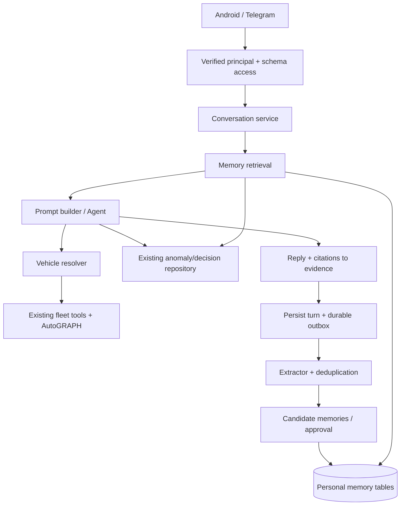

# План реализации памяти ассистента «Петрович»

> **Статус на 20.11.2026:** P0 реализован и принят локально для режима управляемого реестра (`managed`).
> Рабочее включение не выполнялось: `FS_IDENTITY_ENABLED=false`, `FS_IDENTITY_ACCOUNT_LIFECYCLE=unconfigured`.
> Нативный UID AutoGRAPH не подтверждён. Без принятого оператором регламента rename/retire персональный API включать нельзя.
> P1: добавлены миграция и внутренний репозиторий хранения памяти (см. ниже).
> P2: серверные прозвища подключены к tools и opt-in `/v1/chat`; `FS_MEMORY_ALIASES_ENABLED=false`.
> P3: типизированные предпочтения подключены к серверному чату; `FS_MEMORY_PREFERENCES_ENABLED=false`.
> P4: серверный API разговоров и durable recovery реализованы; `FS_CHAT_V2_ENABLED=false`.
> Для закрытия P4 остаётся миграция штатных Android/Telegram-клиентов и UX-приёмка; P5–P6 впереди.

## Приёмка P0 (20.11.2026)

- [x] Серверный Login с явным согласием, отдельные credential/сессия, свежий EnumSchemas, TTL один час.
- [x] Устойчивый UUID в управляемом реестре: rename сохраняет личность, retire и повторная выдача логина создают другую. Аудит, запрет слияния, CLI по умолчанию без записи.
- [x] Изоляция пользователей/схем/провайдеров, подмена заголовков, отзыв без живого AutoGRAPH, конкурентные операции и миграции `0009`/`0010`, включая откат после повторной выдачи логина.
- [x] Android: отдельное согласие, AES-GCM/Keystore, сохранённый отзыв, смена подключения и возврат обратно не оживляют профиль; защита от гонок согласия.
- [x] Персональный Telegram: одноразовый код из private-чата, отдельное подтверждение в приложении, ограничение исходной парой и её сроком, свежие права, отключение. Legacy pairing не даёт личность.
- [x] Проверка контракта безопасности: [решение и ограничения](assistant-memory-p0-security-review.md).
- [x] Общие JSON-контракты Python/Kotlin, тесты бота, JVM и инструментальные проверки Android.

Принятие P0 относится к указанной модели управляемых аккаунтов. Реальный порядок эксплуатации пока не подтверждён оператором; два флага закрывают API до его принятия. Проверенный нативный account ID можно подключить позднее отдельным адаптером. `X-User-Name` никогда не становится доказательством личности.

### Выполненные проверки

Из `ml/fleet_service`, в изолированном Python-окружении с fakes:

```bash
python -m pytest tests/test_identity_memory.py tests/test_identity_telegram.py tests/test_identity_accounts.py tests/test_identity_schema_ids.py tests/test_config.py tests/test_contract.py tests/test_auth.py tests/test_chat_api.py tests/test_logging.py tests/test_store.py tests/test_background.py::test_window_longer_than_telemetry_limit_is_rejected -q --tb=short
```

**146 passed**, 53,35 с; одно предупреждение Starlette об устаревающем транспорте TestClient. Из `ml/telegram_bot`: `python -m pytest -q --tb=short` — **33 passed**, 3,49 с. Включены реальный адаптер aiogram с подставной сессией и сквозной клиент Stand через ASGI.

Android, JDK 17 / SDK 35 / Gradle 8.11.1 в `/tmp/petrovich-android-check`:

```bash
bash /tmp/petrovich-android-check/run-gradle.sh testDebugUnitTest --tests 'ru.petrovich.telemetry.StandIdentityTest' --tests 'ru.petrovich.telemetry.AssistantIdentityTest' --tests 'ru.petrovich.telemetry.RemoteChatAgentTest' --tests 'ru.petrovich.telemetry.StandAnomaliesTest' --tests 'ru.petrovich.telemetry.StandTelegramTest' --console=plain -Pkotlin.compiler.execution.strategy=in-process
```

**50 JVM-тестов, 0 ошибок/пропусков**, BUILD SUCCESSFUL. Собраны `assembleDebug`, `assembleP0test`, `assembleP0testAndroidTest`. Сборка `p0test` имеет отдельный applicationId и только локальные URL; runner запрещает запуск в обычном пакете приложения.

На AOSP Android 26 x86, отдельном программном эмуляторе `petrovich-p0`, фактически выполнены четыре инструментальных запуска: шифрование настоящим Android Keystore и отсутствие открытых секретов в DataStore; отзыв без сети и запрет оживления при возврате настроек; запись профиля; чтение после принудительной остановки процесса. Каждый запуск завершился `OK (1 test)`. Аппаратное устройство/TEE и перенос между двумя устройствами не проверялись; правила исключения DataStore из backup/device-transfer проверены по XML, повреждение/потеря ключа покрыты тестами.

UI-приёмка обычного приложения `.p0test` с настоящим локальным fleet_service и подставным AutoGRAPH:
пароль без согласия не активирует кнопку; после согласия bind и проверка успешны; при имитированной недоступности identity API отключение сразу закрывает профиль и сохраняет отзыв; после восстановления доступности отзыв завершается.
Снимки: [требуется согласие](artifacts/p0/p0-consent-required.png), [привязка](artifacts/p0/p0-profile-bound.png), [ожидающий отзыв](artifacts/p0/p0-revocation-pending.png), [отзыв завершён](artifacts/p0/p0-revocation-complete.png).
В logcat этого тестового эмулятора проверены синтетический пароль, шаблоны credential и AutoGRAPH-токенов: совпадений нет. Это проверка конкретного прогона, не доказательство всех возможных способов утечки.
`git -c core.whitespace=cr-at-eol diff --check` завершился без ошибок; новые текстовые файлы проверены отдельно, семь затронутых JSON-контрактов имеют LF.

Прежние сбои трёх общих эталонов исправлены добавлением уже существующих полей моделей (`feedSource`, `apiUpdatedAt`, `plate`); JSON сохранены с LF. Тест ограничения окна теперь задаёт свой лимит явно, независимо от изменённого значения по умолчанию.

Полный набор fleet_service, Docker smoke и рабочее развёртывание не выполнялись. Все учётные записи синтетические; реальные AutoGRAPH, Telegram, SMTP и LLM не вызывались. Следующий после P0 этап хранения P1 описан ниже; эти результаты относятся только к приёмке P0.

## P1: слой хранения (20.11.2026)

Добавлена независимая миграция `0011` для уже описанных в `store/db.py` девяти таблиц:
разговоры, сообщения, summary, aliases, предпочтения, заметки расследований, кандидаты,
outbox и аудит. Частичные уникальные индексы запрещают дубли активных aliases и настроек.
Откат до `0010` удаляет таблицы памяти вместе с их данными; перед эксплуатационным откатом нужна резервная копия.

`memory/repository.py` реализует внутренние операции:

- Создание и ограниченный постраничный просмотр разговоров и сообщений; проверка владельца и схемы.
- Атомарное сохранение готовой пары user/assistant и события outbox. Повтор `client_message_id`
  с тем же содержимым возвращает прежний `turn_id`; другое содержимое или устаревшая версия дают конфликт.
- Хранение aliases с NFKC/casefold и запретом неявной замены машины; типизированные предпочтения
  `response_length`, `response_format`, `technical_detail`, `language`, `auto_extract_enabled`.
- Удаление разговора очищает тексты и summary, отклоняет кандидатов и отменяет события outbox;
  отдельно сохранённые aliases и предпочтения остаются. Удаление элемента памяти оставляет tombstone,
  очищает его значение и отменяет незавершённую обработку текущего личного scope.
- Аудит содержит только служебные коды и UUID. Проверяются локальный отзыв scope и отключение principal;
  первая DML сериализует проверку и запись между независимыми подключениями SQLite.

Границы этапа: это ещё не API памяти и не рабочая память ассистента. Свежую аутентификацию,
права AutoGRAPH и видимость машины должен обеспечивать вызывающий application service.
На момент приёмки P1 ещё не было resolver/tools P2 и применения предпочтений P3 (добавлены ниже). Pending turn/recovery и HTTP API P4 добавлены ниже. Пока нет
операций заметок расследований P5, extractor/worker/lease completion и UX P6.
Outbox пока только сохраняется и отменяется. Удаление оставляет нормализованный ключ alias
для будущей проверки tombstone; политика физической очистки и восстановления из backup ещё не утверждена.

Проверки P1 находятся в `tests/test_memory_storage.py`: настоящая SQLite без внешних сервисов,
перезапуск и SQLite backup/restore, миграция заполненной БД и metadata, изоляция пользователей/схем/провайдеров,
конкурентные записи через разные engine, откат при отказе outbox, дедупликация, лимиты и удаление.

Выполнен регрессионный запуск из `ml/fleet_service` в отдельном окружении `/tmp/petrovich-memory-venv`:

```bash
python -m pytest tests/test_memory_storage.py tests/test_identity_memory.py tests/test_identity_telegram.py tests/test_identity_accounts.py tests/test_identity_schema_ids.py tests/test_store.py tests/test_auth.py tests/test_chat_api.py tests/test_contract.py tests/test_config.py tests/test_logging.py -q --tb=short
```

**161 passed**, 66,33 с; одно предупреждение Starlette об устаревающем транспорте TestClient.
В песочнице asyncio зависал при пробуждении после `to_thread`; успешный запуск выполнен вне песочницы.
Внешние API не вызывались. Дополнительно отдельно прошли две проверки миграций metadata/downgrade.
Полный набор fleet_service, Android, Telegram, Docker smoke и рабочее включение в рамках P1 не запускались.

## P2: персональные прозвища на сервере (20.11.2026)

`VehicleResolver` общий для `get_vehicle_summary`, `check_vehicle`, `list_anomalies` и списка машин.
ID имеет приоритет; точные официальные имена/номера/label и личные aliases проверяются на неоднозначность.
Нечёткий поиск и склонения не используются. Личная связь не предоставляет права: при подтверждённой
личности EnumDevices вызывается без положительного кэша; закрытые ID не попадают в результаты.
`list_vehicles` показывает только aliases актуально доступных машин текущего principal/scope.

Через `main.build_tools()` зарегистрированы узкие `set_vehicle_alias` и `delete_vehicle_alias`.
Server-side intent берётся только из последнего сообщения пользователя по консервативной грамматике:
`Запомни: Рыжий — veh-1` / `Забудь прозвище Рыжий` / `Забудь название Рыжий`.
Вместо ID допустимы точные доступные имя/номер/label; ссылка из команды копируется в tool без подмены.
История, цитаты, данные tools и неподходящая текущая команда не разрешают запись.
Неявная замена существующей привязки запрещена: нужно явно удалить и заново сохранить её.
Кандидаты неоднозначного выбора содержат только актуально доступные машины.

Миграция `0012` добавляет `memory_alias_operations`: личный scope + `client_operation_id`,
хэш операции и UUID записи. Изменение, аудит и ключ повтора атомарны; другой запрос с тем же ключом
отклоняется. Старое сохранение не оживляет удалённый alias, старое удаление не удаляет новую привязку;
при изменившемся результате возвращается `superseded`, без ложного подтверждения текущего состояния.
Удаление создаёт tombstone даже без активного alias, очищает summary личного scope, отклоняет кандидатов
и отменяет незавершённый outbox. Исторические сообщения остаются до отдельного удаления разговора.

`/v1/chat` включает память только при `FS_MEMORY_ALIASES_ENABLED=true`, разрешённом P0 и предъявлении
`X-Identity-Credential` вместе с исходной сессией и схемой bind. Principal и проверка credential
поступают в ToolContext только с сервера; credential повторно проверяется при работе tools.
`X-User-Name` не выбирает память; legacy Telegram headers не дают личные полномочия.
Без credential остаётся прежний чат. Неверная переданная пара не включает fallback к чужой памяти.
DTO запроса/ответа не менялись. Личные ответы имеют `Cache-Control: no-store`.
Аргументы tools памяти и ссылок на машины не пишутся в лог; SQL-ошибки памяти не раскрывают параметры.
Положительное подтверждение явной команды формируется сервером только по успешному commit,
поэтому текст модели не может сам подтвердить несостоявшуюся запись.

На момент приёмки P2 штатные клиенты ещё не прикладывали identity-пару к чату; тогда проверен серверный opt-in (клиенты v2 добавлены в P4 ниже).
На момент приёмки P2 ещё не было применения предпочтений (добавлено в P3 ниже). Нет автозапоминания, extractor, UI управления памятью и синхронизации разговоров.
Идемпотентность P2 гарантирована при повторе того же `client_operation_id`; P4 ниже добавляет
устойчивый clientMessageId, checkpoint tools и восстановление pending turn при повторах HTTP/LLM.
В P2 источник alias ещё не был привязан к серверному сообщению; история и turn-context добавлены в P4 ниже.
Нормализованный ключ tombstone сохраняется; политика физического удаления и восстановления backup не утверждена.
Рабочие флаги не включались, реальные внешние сервисы не вызывались.

Проверки P2 выполнены из `ml/fleet_service` в `/tmp/petrovich-memory-venv`, вне песочницы из-за
ограничений пробуждения asyncio после потоковых операций, с fakes и временными SQLite:

```bash
python -m pytest tests/test_memory_aliases.py tests/test_memory_storage.py tests/test_fleet_tools.py tests/test_identity_memory.py tests/test_identity_accounts.py tests/test_identity_schema_ids.py tests/test_identity_telegram.py tests/test_agent_loop.py tests/test_store.py tests/test_auth.py tests/test_chat_api.py tests/test_contract.py tests/test_config.py tests/test_logging.py tests/test_emails.py tests/test_gigachat_gateway.py tests/test_eval_tools.py -q --tb=short
```

**350 passed**, 113,76 с. После финальной защиты результата нескольких tools и ограничения вариантов
проведён отдельный заключительный запуск `python -m pytest tests/test_memory_aliases.py -q --tb=short`:
**31 passed**, 19,71 с. Это два запуска с пересекающимися тестами, не 381 уникальный тест.
В каждом запуске одно предупреждение Starlette об устаревающем транспорте TestClient.
Проверены реальные вызовы tools через FakeLLM, авторизация/изоляция, отказ при потере прав и сбое БД,
запрет ложного подтверждения моделью, повтор после удаления/пересоздания и рестарта,
конкурентность разных engine, атомарность alias/аудита/ключа операции, миграции заполненной P1,
metadata и downgrade, отсутствие текста aliases в логах. Ранее устаревшие ожидания fleet tools
актуализированы по существующим полям plate/label; аргументы ссылок на машины теперь намеренно скрыты в логах.
Проверка пробелов затронутых файлов прошла; CRLF существующих файлов и LF новых сохранены.
Полный набор fleet_service, Android/Telegram, Docker smoke и рабочее включение в P2 не выполнялись.

## P3: предпочтения общения на сервере (20.11.2026)

Добавлены закрытая схема `PreferenceValues` (schemaVersion=1), сервис профиля и tools
`get_user_preferences`, `set_user_preference`, `delete_user_preference` через `main.build_tools()`.
`FS_MEMORY_PREFERENCES_ENABLED=false` независим от флага прозвищ. Opt-in — та же проверенная
identity-пара в `/v1/chat`; профиль изолирован по principal/scope, имя из заголовка его не выбирает.
Credential проверяется перед чтением и после него; потеря прав во время чтения закрывает доступ.

Допустимые значения:

- `response_length`: `short`, `normal`, `detailed`;
- `response_format`: `prose`, `bullets`, `conclusion_then_facts`;
- `technical_detail`: `basic`, `advanced`; `language`: только `ru`;
- `preferred_terms`: только `fuel_anomaly` и два проверенных словесных варианта
  «аномалия топлива» / «проблема с топливом», без свободного текста;
- `auto_extract_enabled`: настоящий boolean, по умолчанию false.

Отдельные явные команды последнего сообщения разрешают запись: `Всегда пиши коротко`,
`Всегда отвечай списком`, `Всегда пиши сначала вывод, потом факты`, `Всегда объясняй простыми словами`,
`Всегда объясняй с техническими подробностями`, `Всегда называй аномалии топлива проблемой с топливом`.
Сброс: `Сбрось настройку краткости` (также формата, технических подробностей, языка, терминологии,
извлечения памяти). Угаданные привычки, история, цитаты, вопросы и локальные просьбы не дают согласия.
Сервер подтверждает сохранение/сброс только после успешного commit, даже если модель утверждает обратное.

Сборка prompt получает только повторно проверенный снимок: профиль → локальные настройки чата →
текущая просьба; более правое имеет приоритет. Системные правила и обязательные предупреждения выше
любых стилевых настроек. `В этом чате пиши подробно` действует отдельно от профиля,
`Ответь кратко: что с парком?` — только в текущем запросе. В stateless v1 локальные просьбы
восстанавливаются только из переданной и не отброшенной лимитом пользовательской истории.
Постоянный server-side override с владельцем conversation добавлен в серверной части P4 ниже; клиентская история
никогда не используется как согласие изменить профиль. Новый чат без этой истории снова берёт профиль.

Миграция `0013` добавляет version к каждой записи и журнал `memory_preference_operations`.
Изменение значения, аудит и ключ повтора атомарны; более новая версия или пересозданная запись
делают старую операцию `superseded`. Старое удаление не удаляет новую настройку. Метаданные просмотра
включают источник, дату UTC epoch millis и версию. Откат до `0012` сохраняет прежние ключи и UUID,
но удаляет терминологию, версии и журнал повторов; до операций с рабочей БД нужна резервная копия.

`Не извлекай память из переписки` сохраняет false и отменяет незавершённый outbox/кандидатов
предпочтений. Будущий worker обязан перечитывать `extraction_allowed` перед обработкой; недоступный
профиль и отсутствие явного true запрещают извлечение. `Разрешаю предлагать память из переписки`
сохраняет согласие, но сервер явно сообщает, что extractor пока не запущен. Реального worker ещё нет.
Ошибки/повреждение профиля не передают его текст в prompt/логи и позволяют обычный ответ со стилем
по умолчанию; ошибки явной записи сообщаются пользователю. Автоматическое изменение чисел, единиц,
детекторов, решений и SQL-фильтров отсутствует; серверное предупреждение о резервной модели остаётся.

Границы приёмки: серверная реализация и тесты с fakes; реальные LLM и поведение их стилизации не проверялись.
Клиенты используют персональный чат v2 под выключенными флагами (P4 ниже). Отдельного UI и публичного API настроек пока нет;
tools просмотра/записи/сброса готовы. P4 добавлен ниже; P5–P6,
рабочее включение и политика физической очистки/backup впереди.

Проверки P3 выполнены из `ml/fleet_service` в `/tmp/petrovich-memory-venv`, вне песочницы из-за
ранее диагностированных ограничений asyncio, с подставными сервисами и временными SQLite:

```bash
python -m pytest tests/test_memory_preferences.py tests/test_memory_aliases.py tests/test_memory_storage.py tests/test_fleet_tools.py tests/test_identity_memory.py tests/test_identity_accounts.py tests/test_identity_schema_ids.py tests/test_identity_telegram.py tests/test_agent_loop.py tests/test_store.py tests/test_auth.py tests/test_chat_api.py tests/test_contract.py tests/test_config.py tests/test_logging.py tests/test_emails.py tests/test_gigachat_gateway.py tests/test_eval_tools.py tests/test_breaker.py::test_reply_through_reserve_has_notice_and_warning tests/test_breaker.py::test_reserve_notice_can_be_turned_off -q --tb=short
```

**394 passed**, 216,52 с; одно предупреждение Starlette об устаревающем транспорте TestClient.
Новый набор P3 отдельно: **41 passed**, 25,50 с. Проверены запись/просмотр/сброс после рестарта,
приоритет текущей просьбы и локальной истории без изменения профиля, явное согласие,
изоляция, строгие значения и защита от prompt injection, утечки в логах, отказ/отзыв доступа,
атомарность, версии, повтор операции и конкурентность разных engine, миграции и downgrade,
неизменность JSON телеметрии и предупреждения резервной модели.
Обнаруженный нестабильный тест P1 сравнивал outbox без ORDER BY с упорядоченными сообщениями;
добавлена явная сортировка по next_run_at, производственная логика не менялась для этого исправления.
Проверка пробелов затронутых файлов прошла; новые файлы имеют LF, существующие сохранили CRLF.
Полный набор fleet_service, Android/Telegram, Docker smoke, реальные LLM и рабочее включение не запускались.

## P4: серверный протокол разговоров и клиенты (20.11.2026)

Добавлены `/v2/chat`, создание/список/метаданные/удаление `/v2/conversations` и постраничные
`/v2/conversations/{id}/messages`. `FS_CHAT_V2_ENABLED=false`; нужны разрешённый P0 и проверенная
identity-пара приложения либо отдельно привязанный private Telegram с доверенным ключом бота.
`X-User-Name` не выбирает владельца. Канал задаёт серверный actor; беседы Android/Telegram
доступны своему владельцу, но запись из другого канала отвергается. v1 остаётся прежним протоколом.

`/v2/chat` принимает ровно один content, clientMessageId, expectedVersion, utcOffsetMinutes,
необязательные conversationId/anomalyId/allowEmail/emailContacts. Клиентская история, principal и прочие
поля запрещены. Без conversationId сервер детерминированно создаёт свою беседу по principal/scope/channel
и clientMessageId; указанный неизвестный ID возвращает 404, не создаёт произвольную беседу.
Для нового turn версия должна совпасть; новый вопрос в занятой беседе получает 409.
Повтор неизменного запроса возвращает прежние ID и ответ без LLM/tools либо 202 processing с Retry-After.
Изменение содержимого с тем же ключом — 409. expectedVersion используется при первой записи,
а при повторе уже известного clientMessageId возвращается результат исходного turn.

Миграция `0014`: style_overrides в conversations, conversation_turns с арендой и fencing token,
conversation_tool_calls с хэшами аргументов и результатами. User pending записывается до LLM;
assistant, committed user, версия и outbox — одной транзакцией после генерации. Сеть не удерживает
транзакцию SQLite. Повтор после 504/ошибки/перезапуска использует прежний userMessageId.
При активной аренде новая генерация не запускается. Старый обработчик с другим token не может
дописать ответ. Результаты завершённых tools используются повторно; в восстановленном запросе
новые mutating tools скрыты и запрещены на сервере. Если процесс потерян между started и done,
результат вызова считается неопределённым: 409/state=interrupted, без автоматического повторения.
Это консервативная остановка, а не обещание exactly-once для произвольных внешних действий.

В prompt читается только окно до FS_CHAT_MAX_MESSAGES и FS_CHAT_HISTORY_MAX_CHARS (16000).
Сводка сейчас структурная: версия, границы ID и число оставленных сообщений, без копирования старых
чисел и свободных инструкций; семантическая LLM-компрессия не реализована. System-правило явно отделяет
историю от актуальных показаний. Типизированный локальный стиль сохраняется у беседы и переживает
обрезание окна и перезапуск, не меняя персональный профиль. При утрате доступа к ТС прежние сообщения
скрываются, завершённый ответ не воспроизводится. Проверка консервативна: turn хранит весь разрешённый
на момент начала набор ТС, поэтому потеря любой машины из него скрывает весь turn. Это ограничение
точности provenance, не попытка разрешать доступ по старому кэшу.

Удаление разговора атомарно очищает тексты, summary, style, checkpoint и незавершённый outbox;
поздний ответ не воскрешает беседу. Aliases/профиль и канонические письма не удаляются вместе с чатом.
Очевидные подписанные credentials/пароли маскируются до сохранения и передачи вопроса LLM;
произвольные секреты без узнаваемых меток автоматически определить невозможно.

Письма v2 принадлежат principal, а не присланному имени. Подтверждение/отмена — отдельный
`POST /v2/emails/{id}/confirm|cancel`; инструмент отправки не появился. Служебное пространство
__principal__: закрыто для legacy X-User-Name, чтобы нельзя было подменить владельца v2.
В checkpoint сохраняются только ссылки на письма, не arguments/body; тело остаётся в каноническом
email store. Такой turn не ставится в очередь extraction. Повтор ответа и просмотр истории получают
текущее состояние черновика (cancelled/sent/expired и т. п.) из email store. В исходном user-сообщении
может оставаться введённый пользователем текст; это переписка, не извлечённый факт персональной памяти.

Эталоны `testdata/contract/chat-v2-request.json` и `chat-v2-response.json` имеют LF и проверяются Python/Kotlin.
Android получил DTO v2, загрузку истории в ChatViewModel и отдельный переключатель серверной истории
(default false). До сети сохраняется зашифрованный pending-запрос с исходным clientMessageId и телом;
профиль/сервер/поколение identity входят в scope. Ответ старого профиля отклоняется, UI очищается при
смене аккаунта. «Новый разговор» сохраняет прежний, «Удалить разговор» требует отдельного подтверждения.
Telegram использует `TB_CHAT_V2_ENABLED=false`, личную `/identity` и фактический private actor.
SQLite хранит pointer и отпечаток pending-вопроса без текста, повтор того же вопроса после рестарта
использует исходный ID и параметры. Добавлены `/history`, `/new`, `/delete_conversation confirm`.
Android позволяет явно обновить историю с другого устройства. После interrupted повтор того же вопроса
не создаёт новое действие; пользователь сначала проверяет результат отдельным вопросом.
Карточки писем восстанавливаются с актуальными статусами и собственным principal scope; отправка
остаётся отдельным действием пользователя. Ошибки v2 не переключают клиентов на v1 автоматически.
Полного импорта старой истории нет. Ручная UX-приёмка на устройстве и живой LLM recovery впереди;
управление памятью/candidates через пользовательский API и семантические summary — последующая работа.

Проверки с fakes и временными SQLite, вне песочницы asyncio:

```bash
python -m pytest tests/test_memory_conversations.py tests/test_memory_storage.py tests/test_memory_aliases.py tests/test_memory_preferences.py tests/test_agent_loop.py tests/test_chat_api.py tests/test_config.py tests/test_emails.py tests/test_store.py tests/test_identity_memory.py tests/test_identity_telegram.py tests/test_identity_accounts.py tests/test_identity_schema_ids.py tests/test_fleet_tools.py tests/test_auth.py tests/test_contract.py tests/test_logging.py tests/test_gigachat_gateway.py tests/test_eval_tools.py tests/test_breaker.py::test_reply_through_reserve_has_notice_and_warning tests/test_breaker.py::test_reserve_notice_can_be_turned_off -q --tb=short
```

**410 passed**, 255,75 с. После последних правок правила исторического контекста/эталонов выполнен
отдельный финальный запуск `python -m pytest tests/test_memory_conversations.py -q --tb=short`:
**19 passed**, 20,96 с. Наборы пересекаются; результаты не суммируются. В каждом запуске одно
предупреждение Starlette о транспорте TestClient. Проверены restart/two devices, processing/версии,
таймаут/retry, reuse tools, неопределённый started, fencing, удаление во время LLM, маскирование,
потеря прав, личный Telegram, почтовые статусы, запрет spoof владельца, миграции/metadata/downgrade,
контракты и регрессии P0–P3/v1. Клиентские проверки описаны ниже. Полный fleet_service, Docker smoke,
реальные LLM/AutoGRAPH/SMTP/Telegram и развёртывание не запускались. Рабочий флаг не включался.

Клиентские проверки P4 (20.11.2026):

- Android: `:app:assembleDebug` и выбранные `:app:testDebugUnitTest` для
  `DurableChatAgentTest`, `ChatConversationViewModelTest`, `AssistantIdentityTest`,
  `StandIdentityTest`, `RemoteChatAgentTest`, `EmailDraftsTest`: **55 passed**, сборка успешна.
  Проверены pending после рестарта/202, неизменный ID/тело, interrupted без повторного действия,
  изоляция ответа/шифротекста при смене профиля, актуальное expired письма,
  разные new/delete, v1 при выключенном флаге, контракт Python/Kotlin и заголовки пары.
  Изолированная копия исходников и JDK17/SDK35/Gradle в `/tmp`, без чтения реальной подписи/.env.
  Предварительный полный JVM-прогон: 129 тестов, 127 успешных, 1 skipped, 1 failure —
  `AnomalyGoldenTest.goldenFilesMatchKotlinRules` (demo-0…3). Он не затрагивается задачей;
  эталоны и правила не перезаписывались. Полный прогон поэтому не объявляется успешным.
- Telegram: `python -m pytest -q` из `ml/telegram_bot`: **41 passed**, 1,70 с.
  Использован системный Python 3.12.3 и временные зависимости; Python 3.12.0 исходного окружения
  не импортировал актуальный aiogram (`unhashable FailFast`). Версии проекта не менялись.
  Проверены рестарт SQLite без текста вопроса, повторы/processing/interrupted, scope,
  /new во время запроса, server history вместо ChatState.history, статусы писем, старые кнопки
  чужого профиля, реальные group/private/mismatched actor в aiogram с запрещённой сетью.
- Эмулятор/устройство, Docker smoke, настоящий Telegram/LLM/SMTP и production rollout не запускались.
  Ручная UX-приёмка, политика retention/backup и последующие P5/P6 остаются впереди.

## 0. Краткая постановка задачи

Петрович должен помнить **конкретного пользователя** между сессиями и устройствами: как он разговаривает, насколько подробно хочет получать ответы, какие названия использует для машин, какие вопросы уже обсуждал. Параллельно ассистент должен использовать **общую для разрешённого автопарка** историю реальных аномалий и расследований. Память не имеет права подменять данные AutoGRAPH, менять антифрод-решения или раскрывать данные другого пользователя.

Основные сценарии:

1. Пользователь A: «Запомни: Рыжий — Урал А123ВС» → после однозначной проверки машины ассистент сохраняет **персональный** alias на стабильный `vehicle_id`; позже «Проверь Рыжего» вызывает fleet tool именно с этим ID.
2. Пользователь B использует «Рыжий» для другого ТС. Оба пользователя получают **свою** машину; память одного не влияет на другого.
3. «Отвечай мне коротко, сначала вывод, потом цифры» → предпочтение действует в новых разговорах; «в этом диалоге подробно» меняет лишь текущий контекст.
4. «Посмотри Рыжего, А123ВС» → система может **предложить** сохранить новое прозвище. Неявное предположение без подтверждения не становится проверенным alias.
5. «Как мы разбирали этот случай раньше?» → выводится история доступных пользователю аномалий и решений с привязкой к источникам; предположения механика не выдаются за подтверждённые причины.
6. После перезапуска Android или Telegram-процесса диалог доступен с сервера. Общие пользовательские предпочтения/aliases могут применяться в обоих каналах, **только после безопасного связывания личности**; истории разговоров Android и Telegram не обязаны сливаться в одну беседу.
7. «Забудь название Рыжий» / удаление в настройках → alias перестаёт использоваться немедленно; stale summaries, очереди и индексы не восстанавливают удалённое знание.

### Целевое состояние (Definition of Done всего проекта)

- У каждого запроса к персональной памяти есть подтверждённый `principal_id`, `scope/schema_id` и проверенный набор доступных `vehicle_id`. При отсутствии надёжной идентичности чат может работать **без персональной памяти**.
- Пользовательские aliases разрешаются **детерминированно** в стабильные ID до выполнения операций над телеметрией; при неоднозначности ассистент просит уточнить, а не выбирает случайную машину.
- Предпочтения стиля применяются предсказуемо; текущая явная инструкция сильнее долговременной памяти.
- История диалогов живёт на сервере, восстанавливается после рестартов, поддерживает идемпотентность и разделение пользователей.
- Личные факты, общие сведения автопарка, факты из tools и гипотезы имеют отдельные scope, источники, статус и политику хранения.
- Пользователь может просмотреть, исправить, отключить извлечение и удалить персональную память, отдельно от удаления переписки.
- Ни alias, ни summary, ни текст прошлого расследования не являются источником новых числовых значений телеметрии или разрешением на действие.
- Старый Android/Telegram/`POST /v1/chat`, локальный режим, детекция аномалий, карточки, письма и фоновые задачи работают при выключенной новой памяти.
- Есть автоматические тесты доступа, целостности, консистентности, перезапуска, миграций, LLM extraction, prompt injection и регрессии старых функций. **Все контрольные проверки ниже пройдены.**

## 1. Что подтверждено в репозитории

| Область | Текущее поведение | Источник |
|---|---|---|
| Серверный чат | `POST /v1/chat`; клиент присылает `messages`, сервер обрезает историю до `FS_CHAT_MAX_MESSAGES`, вызывает `build_messages(...)` и `Agent.run(...)` | [`api/chat.py`](https://raw.githubusercontent.com/ErmakovDenis/petrovich/main/ml/fleet_service/src/fleet_service/api/chat.py), [`schemas/chat.py`](https://raw.githubusercontent.com/ErmakovDenis/petrovich/main/ml/fleet_service/src/fleet_service/schemas/chat.py) |
| Агент | Цикл модели и tool calls; `ToolContext` содержит `session`, `schema_id`, UTC offset, необязательное имя и capabilities | [`agent/loop.py`](https://raw.githubusercontent.com/ErmakovDenis/petrovich/main/ml/fleet_service/src/fleet_service/agent/loop.py), [`agent/tools.py`](https://raw.githubusercontent.com/ErmakovDenis/petrovich/main/ml/fleet_service/src/fleet_service/agent/tools.py) |
| Идентичность | `require_session` проверяет AutoGRAPH token и доступ к схеме, но **не извлекает подтверждённый аккаунт пользователя**. `X-User-Name` отдельно не проверяется. Хэш сессии используется как rate-limit key, не как долговременный `user_id` | [`api/deps.py`](https://raw.githubusercontent.com/ErmakovDenis/petrovich/main/ml/fleet_service/src/fleet_service/api/deps.py), [`autograph/session.py`](https://raw.githubusercontent.com/ErmakovDenis/petrovich/main/ml/fleet_service/src/fleet_service/autograph/session.py) |
| Поиск ТС | `find_vehicle_id` поддерживает ID, точное имя, госномер, label среди видимых машин; при отсутствии однозначного совпадения — отказ | [`agent/fleet_tools.py`](https://raw.githubusercontent.com/ErmakovDenis/petrovich/main/ml/fleet_service/src/fleet_service/agent/fleet_tools.py) |
| Аномалии | SQLAlchemy Core + Alembic + SQLite, таблицы `anomalies`, `decisions`; идентификатор события и история решений уже существуют | [`store/db.py`](https://raw.githubusercontent.com/ErmakovDenis/petrovich/main/ml/fleet_service/src/fleet_service/store/db.py), [`store/repository.py`](https://raw.githubusercontent.com/ErmakovDenis/petrovich/main/ml/fleet_service/src/fleet_service/store/repository.py) |
| Миграции и тесты | `store/migrations/versions`, `store/migrate.py`; `tests/test_store.py` сверяет модели и миграции, `tests/conftest.py` содержит подставные сервисы и FakeLLM | [`store/migrate.py`](https://raw.githubusercontent.com/ErmakovDenis/petrovich/main/ml/fleet_service/src/fleet_service/store/migrate.py), [`tests/test_store.py`](https://raw.githubusercontent.com/ErmakovDenis/petrovich/main/ml/fleet_service/tests/test_store.py) |
| Android | `RemoteChatAgent` шлёт полный массив сообщений в `/v1/chat`; `ChatViewModel` хранит историю в `MutableStateFlow`, «Очистить чат» сбрасывает локальные сообщения | [`chat/RemoteChatAgent.kt`](https://raw.githubusercontent.com/ErmakovDenis/petrovich/main/app/src/main/java/ru/petrovich/telemetry/chat/RemoteChatAgent.kt), [`ui/chat/ChatScreen.kt`](https://raw.githubusercontent.com/ErmakovDenis/petrovich/main/app/src/main/java/ru/petrovich/telemetry/ui/chat/ChatScreen.kt) |
| Telegram | У бота есть привязка чата к схеме и текущему имени пользователя, но история `ChatState.history` живёт в памяти процесса; после рестарта теряется. Команда `/new` начинает новый разговор | [`telegram/links.py`](https://raw.githubusercontent.com/ErmakovDenis/petrovich/main/ml/fleet_service/src/fleet_service/telegram/links.py), [`telegram_bot/logic.py`](https://raw.githubusercontent.com/ErmakovDenis/petrovich/main/ml/telegram_bot/src/telegram_bot/logic.py) |
| Ограничения LLM | Системный prompt требует получать все числа из tools, отличать отсутствие данных от нуля и не выполнять инструкции из текстовых данных | [`prompts/system.md`](https://raw.githubusercontent.com/ErmakovDenis/petrovich/main/ml/fleet_service/src/fleet_service/prompts/system.md) |

**Критические уточнения относительно первоначальной идеи:**

- Нельзя брать `user_id = X-User-Name` или `SHA256(AutoGRAPH session)`: первое может быть подменено, второе меняется при перевходе и не доказывает идентичность между устройствами.
- Наличие у Telegram связи `chat_id → schema_id/user_name` само по себе **не означает**, что имя проверено как персональный идентификатор. Cross-channel memory включать после отдельной проверки связывания личности.
- Не нужно заново хранить каждую аномалию как «факт памяти»: `anomalies/decisions` уже являются источником истины. Создавать лишь индексы/производные эпизоды с ссылкой на источник и возможностью его обновления.
- Исходный `ChatViewModel.clear()` сегодня очищает только отображаемую переписку. В новом интерфейсе требуется явно разделить «Новый разговор», «Удалить разговор» и «Удалить память».

## 2. Границы памяти и модель доверия

| Слой | Scope | Что хранить | Что НЕ хранить |
|---|---|---|---|
| **Working / Conversation** | `tenant_id + principal_id + conversation_id` | Последние сообщения, состояние беседы, summary обсуждённого | Бессрочные «проверенные» факты из неподтверждённого текста |
| **Personal Entity Aliases** | `tenant_id + principal_id + entity_type` | «Рыжий» → конкретный `vehicle_id`, источник, подтверждение | Прозвища как глобальные названия ТС; «id по похожему смыслу» |
| **Personal Preferences** | `tenant_id + principal_id` | Формат, краткость, терминология, язык, согласие на извлечение | Предполагаемые личные характеристики, медицинские и иные чувствительные выводы |
| **Operational / Episodic** | `tenant_id + vehicle_id / anomaly_id` | Связи с аномалией, подтверждённые решения, заметки расследования | Утверждение «слив доказан», если есть лишь `CONFIRMED` без установленной причины |
| **Procedural** (позднее) | утверждённый scope организации | Проверенные инструкции с версией и автором | Автоматически созданные правила управления автомобилем/детектором |

**Приоритет источников при ответе:** актуальная телеметрия и проверенный fleet tool → подтверждённые операционные данные → явные пользовательские aliases/предпочтения → непроверенные заметки (с маркировкой «гипотеза») → текущий текст разговора. Память не заменяет текущие данные.

**Приоритет инструкций общения:** ограничения безопасности и приложения → явная инструкция текущего пользователя → его подтверждённые долгосрочные предпочтения → стиль по умолчанию. Текст извлечённой памяти — **данные**, не новая system/developer instruction.

**Граница доступа:** каждый поиск, просмотр, изменение и извлечение памяти выполняется в рамках проверенного principal и tenant; все `vehicle_id`, полученные из памяти, **повторно** сопоставляются с актуальным списком доступных машин из AutoGRAPH. Недоступность AutoGRAPH не означает разрешение доступа из старого кеша.

## 3. Целевая серверная архитектура



**Рекомендация:** модуль внутри `ml/fleet_service`, без отдельного микросервиса, LangChain/GraphRAG и векторной БД в MVP. Использовать текущий SQLAlchemy Core, Alembic, тестовую инфраструктуру и репозиторный паттерн. Сервис `Agent` не должен напрямую знать SQL: чтение памяти, resolver и запись выполнять через отдельные application services. Учитывать, что сервер запускается одним процессом, но все критичные операции должны быть корректны после рестарта и при одновременных запросах.

Предлагаемые новые модули:

```text
ml/fleet_service/src/fleet_service/
  identity/
    principal.py           # модель доверенного пользователя / связывание каналов
    service.py             # серверная проверка личности и scopes
  memory/
    schemas.py             # типизированные DTO и статусы
    repository.py          # операции с таблицами, транзакции
    service.py             # orchestration, чтение/запись
    aliases.py             # нормализация и детерминированное разрешение
    preferences.py         # слияние предпочтений и scope
    retriever.py           # SQL/FTS retrieval и бюджеты контекста
    extractor.py           # structured extraction, без прямого подтверждения
    worker.py              # обработчик durable outbox
    policy.py              # TTL, согласие, удаление, источники
  api/
    identity.py            # новый endpoint подтверждения личности
    memory.py              # посмотреть/исправить/удалить
    conversations.py       # разговоры и сообщения
    chat_v2.py             # новый контракт server-side чата
  agent/
    memory_tools.py        # только узкие tools, без общего unrestricted save
  store/
    db.py                  # описания новых таблиц
    migrations/versions/   # новые Alembic revisions
ml/fleet_service/tests/
  test_identity_memory.py
  test_memory_aliases.py
  test_memory_api.py
  test_memory_extraction.py
  test_memory_conversations.py
  test_memory_security.py
  test_memory_regression.py
```

Пути выше — целевая структура. Модули identity, API/DTO идентичности и тесты P0 уже добавлены; остальные модули памяти ещё предстоит реализовать.

## 4. Обязательное решение №1 — идентичность пользователя (P0, блокирующий этап)

### Проблема

`require_session` подтверждает право **токена** видеть схему, но не возвращает долговременный identity; `X-User-Name` клиенту разрешено подставлять произвольно. Использовать его как ключ памяти или ключ права `DELETE /memory` нельзя.

### Выбранное для плана направление

Ввести `Principal`, создаваемый **только сервером** на основании проверенной учётной записи. Предпочтительный вариант зависит от возможностей AutoGRAPH:

1. **Проверить существование надёжного AutoGRAPH endpoint идентификации** для валидированной сессии (стабильный user/account ID). Если он есть — получать ID с сервера AutoGRAPH и фиксировать провайдера идентичности.
2. **Если такого endpoint нет** — добавить отдельный `identity/bind` на стенде: после явного согласия пользователя проверять username+password через серверный AutoGRAPH Login и права на схему, создавать стабильный principal, выдавать собственный короткоживущий/обновляемый защищённый credential для персональных операций. Пароль не сохранять для памяти и не логировать. Credential хранить безопасно на устройстве, поддержать revoke; текущее право на схему проверять независимо. Точный контракт требует security review. Нельзя считать простое совпадение client-side username достаточным доказательством.
3. Telegram привязывать к **этому principal**, проверяя одноразовую пару в уже аутентифицированной сессии приложения; переиспользовать механику pairing только после проверки, что она аутентифицирует тот же аккаунт, а не просто схему/подписку. Групповые чаты не используют персональную память участников по умолчанию.

```python
# Новый внутренний тип, пример контракта:
@dataclass(frozen=True)
class Principal:
    tenant_id: str             # первоначально scope схемы AutoGRAPH
    principal_id: str          # стабильный ID, НЕ произвольный заголовок
    source: str                # autograph_verified / stand_bound
    verified: bool
    allowed_schema_ids: frozenset[str]
```

**Критерии P0:** перезаход и смена AutoGRAPH token не меняют `principal_id`; подмена `X-User-Name` не меняет память; разные пользователи одной схемы не читают друг друга; неподтверждённая привязка Telegram не открывает память; после отзыва credential персональный API закрыт; в логах нет токенов/паролей. Пока P0 не готов — **FS_MEMORY_ENABLED=false** для персональной памяти.

## 5. Данные и миграции (P1)

Реализовать таблицы через `store/db.py` + **новую Alembic revision**, не через `metadata.create_all()` в production. Время — UTC (в стиле существующего `store/db.py`). Ниже логическая схема, а не готовый Alembic-файл:

| Таблица | Поля / ключи | Ограничения |
|---|---|---|
| `principals` | `principal_id`, `provider`, `provider_subject`, `created_at`, `disabled_at` | Уникальная пара `(provider, provider_subject)`, идентичность не из client headers |
| `principal_scopes` | `principal_id`, `tenant_id`, `linked_at`, `revoked_at` | Уникальная активная привязка и повторная проверка актуальных прав |
| `conversations` | `id`, `tenant_id`, `principal_id`, `channel`, `created_at`, `updated_at`, `version`, `deleted_at` | Чтение/запись только владельца; `channel=android/telegram` |
| `conversation_messages` | `id`, `conversation_id`, `client_message_id`, `role`, `content`, `state`, `created_at`, `turn_id` | UNIQUE `(conversation_id, client_message_id)` для user turns; длина/объём ограничены |
| `conversation_summaries` | `conversation_id`, `version`, `summary`, `source_range`, `updated_at` | Перегенерация при удалении, проверка версии и источников |
| `user_entity_aliases` | `id`, `tenant_id`, `principal_id`, `entity_type`, `entity_id`, `alias`, `normalized_alias`, `status`, `source_message_id`, `created_at`, `updated_at`, `deleted_at` | UNIQUE активного `(tenant_id, principal_id, entity_type, normalized_alias)`; entity_id — стабильный ID |
| `user_preferences` | `id`, `tenant_id`, `principal_id`, `key`, `value_json`, `source_type`, `status`, `updated_at`, `deleted_at` | Предопределённые ключи; JSON валидировать, не хранить произвольный prompt |
| `investigation_notes` | `id`, `tenant_id`, `anomaly_id`, `vehicle_id`, `author_id`, `note`, `status`, `created_at`, `updated_at` | Ссылка на существующую аномалию, provenance, append-only audit изменений |
| `memory_candidates` | `id`, `tenant_id`, `principal_id`, `kind`, `payload_json`, `evidence_message_id`, `status`, `expires_at` | `pending/accepted/rejected/expired`; дедупликация |
| `memory_outbox` | `id`, `event_type`, `aggregate_id`, `payload_ref`, `state`, `attempts`, `next_run_at` | Durable post-turn extraction; повторная обработка идемпотентна |
| `memory_audit` | `id`, `principal_id`, `action`, `target_type`, `target_id`, `at`, `reason` | Без содержания удалённой памяти и секретов |

Примечания к дизайну:

- Для SQLite частичный уникальный индекс по `deleted_at IS NULL`/активному статусу реализовать явно в миграции и SQLAlchemy metadata; не полагаться на `UNIQUE` по nullable-колонкам.
- Имена aliases нормализовать осторожно: Unicode NFKC, `casefold`, trim/collapse spaces; не делать расплывчатый fuzzy match регистрационных номеров. Сохранять исходное отображаемое имя отдельно.
- Разрешать несколько разных aliases для одного ТС, но **один alias → не более одного активного ТС** в одном личном scope. При смене привязки — подтверждённая замена + аудит.
- `tenant_id` в MVP можно связать с `schema_id` AutoGRAPH; подтвердить в проекте, соответствует ли схема организационной границе. Не склеивать сведения разных организаций по совпадающим `vehicle_id`.
- Для расследований не создавать дубликаты `decisions` как самостоятельную правду. Потребитель обращается к canonical anomaly/decision store и соединяет `investigation_notes` по ссылке.
- Для удаления: мягкая пометка + tombstone/запрет репопуляции, очистка кеша/индекса/кандидатов/summary; физическая очистка в соответствии с утверждённым retention policy. Срок и политика восстановления из backup подлежат согласованию.

**Критерии P1:** upgrade на пустой и заполненной БД; сравнение metadata↔миграции; миграция `downgrade` на тестовой копии (либо документированная необратимость); после рестарта записи сохраняются; уникальность и idempotency соблюдены; старые таблицы и `AnomalyRepository` не ломаются.

## 6. Персональные названия машин — MVP/P2

### Чтение: deterministic entity resolution

Вынести общий `VehicleResolver` и интегрировать его в **все** fleet/store tools, принимающие `vehicle_id` (не только `get_vehicle_summary`). Последовательность:

1. Получить проверенный principal и актуальный набор `visible_vehicle_ids` от `TelemetryService.vehicles(session, schema_id)`.
2. Сначала проверить **точный допустимый ID**, затем точное имя/госномер/label из доступных ТС (существующее поведение). Для текстового прозвища искать активные aliases текущего principal в **текущей схеме**.
3. Если совпадение единственно и ID всё ещё видим — вернуть канонический `vehicle_id`; alias показать в ответе вместе с формальным label/plate по необходимости.
4. Если пользовательский alias конфликтует с официальным именем/номером другой машины или совпадение неоднозначно — предложить конкретные варианты и попросить подтверждение. Не угадывать.
5. Если Alias есть, но права на машину отозваны/она удалена — отказать в доступе; можно предложить удалить устаревшее прозвище, но **не показывать закрытую телеметрию**.
6. После успешного resolution tools получают только реальный ID, а не «Рыжий». При отсутствии подтверждённого principal действует старый точный resolver без персональных прозвищ.

**Запись alias:**

- Добавить узкий tool `set_vehicle_alias` (`alias`, `vehicle_reference`, `client_operation_id`) и `delete_vehicle_alias` (`alias`, `client_operation_id`). Аргументы не могут содержать произвольный `principal_id` или `tenant_id`: scope берётся из проверенного `ToolContext`. Права на фактический `vehicle_id` проверяются сервером в момент commit. Вызов записи разрешён только при явном пользовательском намерении в текущем запросе; операция идемпотентна. Для неполного/двусмысленного запроса tool возвращает `confirmation_required`, а не записывает факт.
- Явное «Запомни, Рыжий — машина А123ВС»: backend подтверждает однозначность и доступ, затем сохраняет alias через ограниченный tool; отвечает «запомнил» **только после успешного commit**.
- «А123ВС — наш Рыжий» без явной команды: LLM extraction создаёт **candidate**, UI спрашивает «Сохранить название?»; без подтверждения alias не используется как установленный факт.
- «Рыжий теперь — В456ОР»: требует явной замены связи с подтверждением старой/новой машины.
- «Забудь Рыжего»: удаляет персональный alias (не машину), инвалидирует кеши и summary/кандидаты, где связь могла пережить удаление. Создать suppression/tombstone, чтобы старые сообщения и повторная extraction не создавали связь снова. Если текст старой беседы остался, он может исторически содержать слово «Рыжий»: это **не** право использовать его как активную привязку. Для полного удаления самого упоминания нужно отдельно удалить/очистить соответствующую переписку.
- Полностью неизвестное имя → уточняющий вопрос, **не** произвольная fuzzy-идентификация.

**Критерии P2:** tool записи и удаления реально вызван в end-to-end сценариях с FakeLLM; подтверждение только после commit; 100% точность на детерминированных тестах известных aliases; изоляция A/B; корректность смены ID, удаления и потери прав; все tools используют один resolver; старый поиск по plate/name не регрессирует.

## 7. Стиль общения — P3

Ввести версионированные **типизированные** preferences, например:

```json
{
  "response_length": "short",
  "response_format": "conclusion_then_facts",
  "technical_detail": "basic",
  "language": "ru",
  "preferred_terms": {"fuel_anomaly": "проблема с топливом"},
  "auto_extract_enabled": false
}
```

Предпочтения языка/длины/формата не должны менять измеренные факты, значения, метрики, безопасность и текст обязательных предупреждений. `preferred_terms` влияет только на словесное описание, а не на типы аномалий и SQL-фильтры.

**Правила обновления:**

- Явное долговременное указание («всегда пиши коротко») → проверка допустимого ключа и сохранение; отвечать после commit.
- Явное локальное указание («в этом чате распиши подробно») → override в conversation, не заменяет долговременное preference.
- Наблюдаемый стиль без указания → только кандидат с evidence/предложением; в MVP автозапись привычек **отключена**.
- Просмотр/редактирование в интерфейсе имеет приоритет над догадками extractor; при конфликте показывать источник и дату.

**Критерии P3:** после нового диалога preference работает; локальный override не меняет профиль; настройка «не извлекать из переписки» полностью выключает extraction; формат не отменяет disclaimer и не меняет чисел.

## 8. Серверная история разговоров — P4

### Контракт API

Рекомендую **не ломать** текущий `/v1/chat` и ввести отдельный контракт `/v2/chat` (возможен другой versioned path по соглашениям проекта). Пример:

```json
POST /v2/chat
{
  "conversationId": "conv_...",
  "clientMessageId": "uuid-generated-on-client",
  "expectedVersion": 7,
  "content": "Проверь Рыжего",
  "utcOffsetMinutes": 300,
  "anomalyId": null,
  "allowEmail": false
}
```

```json
200 OK
{
  "conversationId": "conv_...",
  "userMessageId": "msg_...",
  "assistantMessageId": "msg_...",
  "version": 8,
  "reply": "...",
  "drafts": []
}
```

Если диалога ещё нет, endpoint создаёт его в собственном scope пользователя. `conversationId` **никогда** не является полномочием доступа. Для всех операций проверять собственника и scope. Новые endpoint'ы: `GET /v2/conversations`, `GET /v2/conversations/{id}/messages` с пагинацией, `POST /v2/conversations` (новый чат), `DELETE /v2/conversations/{id}` (удалить), `GET/PATCH/DELETE /v2/me/memory` (отдельные типы), `POST /v2/me/memory/candidates/{id}/accept|reject`.

Правила обработки turn:

1. Проверить principal, права, лимиты; загрузить разговор и его server-side summary/history (не доверять переданному клиентом контексту как истории).
2. Записать user turn с уникальным `clientMessageId` и статусом `pending` в транзакции; конкурентные turn'ы в одном разговоре сериализовать либо возвращать `409` по `expectedVersion`.
3. Выполнить retrieval и LLM/tool loop с существующими timeout/rate/feature flags. Не удерживать SQL-транзакцию во время сетевого вызова LLM.
4. Записать assistant turn и completed state, вместе с outbox event; только затем сообщить клиенту об успешном сохранении. При истечении времени/ошибке вернуть корректный статус и сохранить возможность retry/recovery без двойного turn.
5. Повтор с тем же `(conversationId, clientMessageId)` возвращает прежний результат или состояние обработки; **не делает второй tool call**, не дублирует письма или кандидатов.
6. Compact старые сообщения в summary с бюджетом токенов и ссылками на диапазоны; не помещать в prompt всю историю. Для side effects (`draft_email`) сохранить существующую серверную модель подтверждения; пользователь должен видеть актуальный статус черновика.

**Миграция клиентов:** Android `RemoteChatAgent.kt` переключается на новый контракт под feature flag и хранит только идентификатор текущей беседы; `ChatViewModel` загружает историю с сервера, `clear()` = **новый разговор**, отдельный UI «Удалить разговор». Telegram заменяет `ChatState.history` серверными conversation ID, `/new` создаёт новый conversation; технические состояния Telegram review/pending_reason остаются отдельно, пока не будут явно перенесены. Клиенты с прежним API работают как раньше, без бесшовной персональной истории. Не делать автоматический импорт клиентских сообщений без deduplication и подтверждённого владельца.

**Критерии P4:** рестарт сервера, Android и Telegram не стирает историю; два устройства видят свой conversation после обновления; восстановление после 504/retry не плодит дубли; одновременные сообщения не перепутаны; очистка чата не удаляет aliases; удалённый чат не просачивается в summary.

## 9. История расследований — P5

Использовать существующие `anomalies` и `decisions`, чтение через ограниченный по `schema_id` и visible vehicles `AnomalyRepository`. Добавить только `investigation_notes` с источником, датой, автором и статусом:

- `observation` — наблюдение;
- `hypothesis` — возможная причина;
- `verified_reason` — причина, подтверждённая отдельным доказательством/ответственным;
- `action` — выполненное действие и подтверждение выполнения.

Новые инструменты (узкие, с контролируемыми аргументами): `get_vehicle_history`, `search_investigations`, `get_investigation`, `add_investigation_note` (последний только с проверенными полномочиями и явным запросом/подтверждением, не свободная автозапись). Класс `resolution=CONFIRMED` означает только статус, определённый существующим API; **не** автоматически доказанный слив.

MVP retrieval: `tenant_id + visible_vehicle_ids + vehicle_id + kind + time range + status`, с ограничением размера и ссылками на конкретные `anomaly_id`/`decision_id`. SQLite FTS5 позднее при большом количестве текстовых заметок; embeddings/pgvector — **после** измеримого улучшения на evaluation dataset.

**Критерии P5:** ассистент корректно отличает прошлое от текущего, решение от причины, гипотезу от факта; исправление/отмена решения обновляет выдачу; удалённые или недоступные события не раскрываются; поиск не меняет детектор.

## 10. Извлечение и поддержание памяти — P6

- Извлекать **строго типизированные кандидаты** (`alias`, `preference`, `investigation_note`) через LLM с JSON Schema/Pydantic и ссылками на исходные user messages. Валидация разрешённого типа и фактов о сущностях — в коде, **не** через уверенность модели.
- Использовать уже сохранённые committed messages через `memory_outbox`, а не best-effort `asyncio.create_task()` без durable state. Idempotency key по `event_id + memory_kind + normalized_key`; retries с backoff, capped attempts и dead-letter статусом.
- Для косвенных связей `candidate → confirmation → accepted`. Никогда не сохранять по словам, которые модель придумала; предусмотреть явное согласие пользователя на автопредложение памяти.
- Объединять повторы и противоречия; более новая запись не перезаписывает подтверждённую без policy. Поддержать `superseded`, `rejected`, `deleted` и журнал происхождения.
- После удаления проверять outbox/candidate, чтобы старое событие не воссоздало alias. Обработчик должен учитывать tombstone и актуальную настройку consent **на момент обработки**.
- Не передавать в память tokens, passwords, email body, secrets и чувствительные сведения из произвольного диалога. Модельные вызовы соответствуют настройкам обработки данных поставщика LLM.

**Критерии P6:** повторная обработка события не дублирует память; конфликт требует подтверждения; удаление не самовосстанавливается; отказ LLM extractor не ломает основной чат; из текстов данных и старых сообщений не исполняются инструкции.

## 11. Prompt и безопасность tools

Обновить [`agent/prompt.py`](https://raw.githubusercontent.com/ErmakovDenis/petrovich/main/ml/fleet_service/src/fleet_service/agent/prompt.py) и [`prompts/system.md`](https://raw.githubusercontent.com/ErmakovDenis/petrovich/main/ml/fleet_service/src/fleet_service/prompts/system.md):

1. Блок `User preferences` — только валидированные ключи и значения, лимит длины.
2. Блок `Relevant personal aliases` — короткий список только по видимым ТС.
3. Блок `Conversation summary` — непроверенные прошлые высказывания, явно помеченные как контекст.
4. Блок `Operational evidence` — ссылки на проверенные события и версии данных; источники обязательны в формулировках о расследовании.
5. Заранее сохранённые описания/aliases/summary трактуются как **непроверенный текст данных**, а не как команды. Безопасность и доступ проверяет backend, не prompt.

Изменение `ToolContext`: передавать trusted `Principal`/`principal_id` из server-side dependency, а не принимать `principal_id` из аргументов модели. Привязка к vehicle выполняется в tools на сервере. Модель не получает универсальную возможность менять SQL или принимать окончательные решения по антифроду. Для нового memory tool выставить `log_arguments=False`, если аргументы содержат текст сообщений/заметок.

## 12. Порядок внедрения, gates и rollback

| Шаг | Результат PR | Что должно пройти перед merge | Откат |
|---|---|---|---|
| **P0. Identity** (блокер) | Надёжный principal; подтверждённая привязка Android/Telegram | Cross-user и header-spoof тесты, session rotation/revoke, no secrets | Не включать личную память |
| **P1. Storage** | SQLAlchemy Core + Alembic tables, repositories | upgrade/compare_metadata/restart/конкурентность/backup | Выключить память; схема остаётся до контролируемого downgrade |
| **P2. Aliases** (**первый полезный MVP**) | Resolver + CRUD alias + явное «запомни» | A/B изоляция, collision, stale permission, все fleet tools | `FS_MEMORY_ALIASES_ENABLED=false` |
| **P3. Preferences** | Валидированные настройки ответа + временные overrides | Test precedence, сохранение между разговорами, 0 влияния на числовые факты | `FS_MEMORY_PREFERENCES_ENABLED=false` |
| **P4. Conversations** | `/v2/chat`, серверные turns/summaries, Android и Telegram adapters | Restart/retry/concurrency + совместимость `/v1/chat` и email drafts | Клиенты обратно на v1, без потери старых данных |
| **P5. Investigations** | Поиск предыдущих случаев/заметки/источники | Источники/видимость/различие причины и статуса | Выключить episodic retrieval/tools |
| **P6. Extraction + UX** | Candidates, outbox, экран памяти, удаление/экспорт | Injection, dedup, deletion, UX e2e, performance | `FS_MEMORY_EXTRACTION_ENABLED=false` |

Рекомендуемый порядок **не менять**: P2/P3/P4 нельзя безопасно выпускать для нескольких реальных пользователей до P0. Можно отдельно реализовывать миграции, mocks и UI, не включая feature.

Настройки (предлагаемые): `FS_MEMORY_ENABLED` (default `false`), `FS_MEMORY_ALIASES_ENABLED`, `FS_MEMORY_PREFERENCES_ENABLED`, `FS_MEMORY_CONVERSATIONS_ENABLED`, `FS_MEMORY_INVESTIGATIONS_ENABLED`, `FS_MEMORY_EXTRACTION_ENABLED` (все default `false`), лимиты результатов и prompt token budget, retention. Feature flags должны иметь server-side precedence и не включаться самими клиентскими запросами. Отдельный soft rollout сначала на тестовый scope.

## 13. Матрица обязательных проверок

| ID | Тип | Сценарий | Ожидаемый результат |
|---|---|---|---|
| SEC-01 | Auth | A и B в одной схеме, одинаковый alias «Рыжий» на разные ТС | Строгая изоляция, правильный ID для каждого |
| SEC-02 | Auth | A подменяет `X-User-Name` на B | Не получает и не изменяет память B |
| SEC-03 | Auth | AutoGRAPH token истёк/схема отозвана | 401/403 или отказ данных, **без** обхода через память |
| SEC-04 | Auth | Alias указывает на машину, которую больше не видно | Tool не раскрывает телеметрию |
| SEC-05 | Auth | Подмена `conversationId`/`messageId` другого пользователя | 403/404 без утечки содержимого |
| SEC-06 | Auth | Telegram linked/unlinked, другой chat_id или групповой чат | Нет доступа к чужой персональной памяти |
| SEC-07 | Input | Prompt injection в alias, заметке, summary или названии ТС | Инструкция игнорируется, нет опасного вызова tools |
| AL-01 | Unit | «Запомни Рыжий — А123ВС», уникальный видимый plate | Alias сохраняется на ID и применяется после новой сессии |
| AL-02 | Unit | Одинаковое прозвище в разных организациях | Нет пересечения scopes |
| AL-03 | Unit | Один alias соответствует нескольким объектам/конфликтует с официальным именем | Уточнение, не произвольный выбор |
| AL-04 | Unit | Перемена alias / удаление / переподключение ТС | Прежняя связь не используется, есть аудит |
| AL-05 | Integration | `get_vehicle_summary`, `check_vehicle`, `list_anomalies` с прозвищем | Разрешается один и тот же canonical ID |
| PREF-01 | Unit | «Всегда кратко» → новая беседа | Предпочтение сохранено |
| PREF-02 | Unit | «В этой беседе подробно» | Только локальный override |
| PREF-03 | Regression | Стиль короткий, а телеметрия отсутствует | Не придумывает число и не скрывает предупреждение |
| CHAT-01 | Integration | Новый conversation, несколько turns, рестарт backend/client | История восстановлена |
| CHAT-02 | Integration | Одинаковый `clientMessageId` повторён после timeout | Один user turn, один assistant turn, нет повторных side effects |
| CHAT-03 | Concurrency | Два одновременных turn в одной беседе | Сериализация или 409; порядок сохранён |
| CHAT-04 | Regression | Старый `POST /v1/chat` и Android old mode | Контракт и поведение неизменны |
| CHAT-05 | Regression | Письмо: draft → confirm/cancel, затем повторный chat | Не создаёт повторной отправки, статус соответствует серверу |
| HIST-01 | Integration | `CONFIRMED` без verified cause | Не называется доказанным сливом |
| HIST-02 | Integration | Решение отозвано или anomaly merged | Retrieval отражает актуальную историю |
| MEM-01 | Unit | Из двух диалогов одинаковый candidate | Один ожидающий кандидат, проверенный source |
| MEM-02 | Integration | Удаление alias при pending outbox | Alias не воскресает после воркера/рестарта |
| MEM-03 | Privacy | Удаление беседы, затем поиск/summary | Удалённый текст не используется и не возвращается |
| MEM-04 | Reliability | LLM для extractor недоступна | Главный чат работает, outbox повторяет позже |
| MEM-05 | Privacy | Запрет auto-extraction, последующие сообщения | Новые кандидаты не появляются |
| DB-01 | Migration | upgrade заполненной SQLite БД, rollback сценарий | Старые аномалии/решения/письма целы |
| DB-02 | Migration | `compare_metadata`, индексы, уникальность | Схема кода соответствует migration head |
| OPS-01 | Load | Параллельные запросы/потеря сети/длинная история | Лимиты, токены и таймауты соблюдены; нет блокировки БД на весь LLM call |
| OPS-02 | Security | Логи и API errors | Нет session token, password, raw memory contents и персональных секретов |

### Evaluation dataset и предварительные quality gates

Собрать отдельный **ручной golden dataset** без приватных продакшен-секретов: минимум 50 диалоговых кейсов, в том числе 20 сценариев прозвищ (неоднозначные/смена/удаление/два пользователя), 15 сценариев предпочтений, 15 эпизодических запросов; включить negative cases и несколько сессий одного человека.

В CI прогонять deterministic tests с FakeLLM и fake AutoGRAPH; LLM-sensitive задачи дополнить фиксированным набором вызовов моделей в отдельном контролируемом evaluation job. Численные ориентиры **как критерии приёмки**, а не как уже достигнутые результаты:

- **0** успешных cross-user, cross-tenant, cross-vehicle access violations во всех security fixtures.
- **100%** корректного разрешения заранее подтверждённых однозначных aliases и отказов в неоднозначных кейсах.
- **≥95% precision** предложений об извлечении предпочтений/aliases на ручной выборке (при наличии достаточного числа положительных и отрицательных примеров); все автосохранённые записи имеют валидное evidence и проходят серверную проверку.
- **≥90% Recall@5** для поиска нужных инцидентов на ручном наборе, когда будет введён episodic retrieval; SQL baseline сравнивать с FTS/semantic retrieval.
- No regression: `pytest` fleet_service, существующие golden-тесты телеметрии/детектора, Android unit/instrumented tests и Telegram tests проходят.
- Контролировать p50/p95 overhead memory retrieval, размер prompt, токены на summarization/extraction, долю ошибок outbox, duplicate rate, retention и нагрузку на SQLite. Числовой latency budget утвердить по baseline замерам **до** подключения памяти, не назначать произвольно.

### Проверки командами (после реализации)

```bash
# Backend: из корня ml/fleet_service
python -m pip install -e '.[dev]'
python -m pytest
python -m pytest tests/test_store.py tests/test_memory_aliases.py tests/test_memory_security.py -q

# На отдельной ТЕСТОВОЙ БД, а не на production
python -m fleet_service.store.migrate upgrade
# Прогон downgrade/upgrade — только на копии БД и с выбранной конкретной ревизией

# End-to-end smoke: после запуска сервисов из корня репозитория
ml/fleet_service/scripts/smoke.sh
```

Команды для новых `test_memory_*.py` будут работоспособны **после создания** соответствующих файлов. Для Android/Telegram запускать существующие тестовые команды, сверив их с актуальным проектом; не утверждать, что тесты уже прошли. В отдельном ручном плане проверить два реальных аккаунта одной схемы, два устройства, перезапуск бота, отсутствие сети, восстановление из резервной копии, переход на новый/старый клиент.

## 14. Пользовательский интерфейс

Android: `Настройки → Память Петровича` с вкладками «Как я называю машины», «Как со мной общаться», «История диалогов» и настройкой «Предлагать запоминать из бесед». Для каждой записи: alias/значение, привязанная машина (официальное имя + plate), источник/дата, изменить/забыть. Отдельные действия: «Начать новый разговор», «Удалить разговор», «Удалить мои персональные воспоминания». **Не** обещать уничтожение всех резервных копий немедленно; показать политику хранения. Для Telegram — минимальные команды просмотра/забывания и ссылка на настройки приложения, без раскрытия лишних данных в группах.

Во время обучения: компактное подтверждение «Сохранить ‘Рыжий’ как название Урал А123ВС?» с явными действиями **Сохранить / Не сохранять**. Не делать скрытую запись по каждому упоминанию и не показывать «запомнил» до фиксации транзакции.

## 15. Ограничения безопасности, privacy и эксплуатации

- Требуется согласованная политика retention для conversations, кандидатов, алиасов, аудита и backups. Разделить «выключить извлечение», «удалить разговор», «забыть конкретный факт», «удалить весь профиль». Проверить права на экспорт и удаление.
- Не записывать сырые body писем, пароли, токены, номер телефона сотрудника без обоснованной необходимости и подтверждённого доступа. Scrub/redact в логах, trace, prompt-кешах и error messages.
- Текущие fallback-модели и LLM routing в проекте могут менять поставщика; требования по передаче персональной памяти каждой модели/провайдеру и consent должны быть явно согласованы.
- Prompt injection: текст расследования, alias, summary и ответ стороннего инструмента может быть злонамеренным. Backend проверяет scope/ACL/разрешённые аргументы **после** работы модели.
- Синхронизация и недоступность memory store: без памяти обычные fleet tools и существующий `/v1/chat` продолжают работать. Если пользователь просит **сохранить** память, ошибка БД должна быть показана явно; нельзя ложно подтверждать успех.
- Ветки отката: feature flags / versioned API. Не проводить тяжёлую миграцию всей истории без отдельной политики и подтверждённой идентичности владельца.
- SQLite достаточно для MVP при текущей архитектуре одного server process и аккуратных коротких транзакциях. Если нагрузка вырастет, планировать переход на PostgreSQL по метрикам, а не ради наличия pgvector.

## 16. Порядок работы coding agent над реализацией

Каждый этап выполнять отдельным PR с явным gate. В PR обязательно:

1. Список изменённых файлов и новых миграций.
2. Краткая спецификация API/DTO и совместимости.
3. Security/authorization boundary: откуда взят principal, как проверены schema и visible vehicles.
4. Изолированные unit tests, интеграционные тесты с FakeLLM/AutoGRAPH и regressions.
5. Результаты конкретно выполненных команд (pass/fail), а не заявления «должно работать».
6. Ручные сценарии и скриншоты/протокол UI, если менялся клиент.
7. Новые настройки `.env.example`, README/DEPLOY, процедуры backup/rollback.
8. Критерии приёмки текущего этапа в виде чек-листа; переход к следующему только после их выполнения.

**Рекомендуемый первый PR:** исследование/реализация P0: как AutoGRAPH доказывает конкретный аккаунт; server-side identity contract и security tests. **Первый функциональный релиз после P0/P1:** P2 (пользовательские названия машин) + минимальный экран управления ими. Не начинать с embeddings, summary LLM или «умного» extraction.

## 17. Самопроверка этого плана: факты, допущения, незакрытые решения

### Подтверждено проверкой источников

- В репозитории действительно есть `POST /v1/chat`, `Agent.run`, `ToolRegistry`, server-side anomaly store, SQLAlchemy/Alembic, локальная Android chat history и in-memory Telegram history.
- Identity gap реален: текущая проверка AutoGRAPH даёт доступ к схеме, **но** не возвращает стабильный account ID; `X-User-Name` явно указан в коде как непроверенный.
- `find_vehicle_id` уже делает точное сопоставление видимых ID/имен/номеров. Нужно **расширить** существующее разрешение, а не создавать второй независимый поиск без ACL.
- Системный prompt требует все числа получать из инструментов и не выполнять команды из строк данных; новая память должна сохранять эти инварианты.
- Миграции при старте, SQLite WAL, тесты на структуру БД и mock-зависимости существуют.

### Требует проверки перед реализацией

- Предоставляет ли установленная версия AutoGRAPH надёжный `whoami`/account ID по токену; если нет, согласовать безопасный identity enrollment и миграцию клиента.
- Является ли `schema_id` корректным tenant boundary для всех пользователей и организаций.
- Какие требования к срокам хранения, удалению из backup и передаче личных данных LLM-провайдерам.
- Нужно ли разрешать одну и ту же персональную память на Android и Telegram **автоматически** или только после отдельного opt-in.
- Какие роли могут добавлять подтверждённую причину расследования; сейчас `CONFIRMED` само по себе не является причинной меткой.
- Окончательные URL API, feature flag naming, формат secure storage на Android и UX подтверждения — предлагаемые решения, а не текущий контракт.

### Что этот документ НЕ заявляет

- Что новая память уже реализована или протестирована в живом приложении.
- Что какой-либо AutoGRAPH endpoint для идентификации точно существует.
- Что `X-User-Name`, Telegram `user_name` или session hash сейчас подходят для безопасной персональной памяти.
- Что embeddings или vector database требуются для MVP.
- Что `CONFIRMED` в антифроде доказывает факт мошенничества или причину аномалии.

---

**Итог:** главный результат — Петрович надёжно узнаёт **своего** пользователя, понимает **его** названия машин и стиль общения, помнит доступный контекст разговоров и извлекает подтверждённые факты из истории парка. Центральные приоритеты: `verified identity → aliases → preferences → conversations → investigations → automatic extraction`, с независимой проверкой и возможностью отключить каждый слой.
